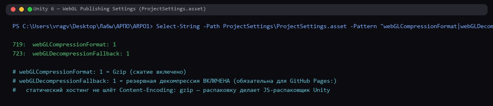
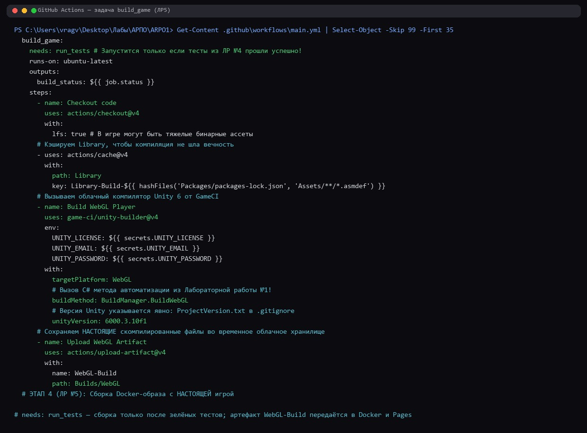
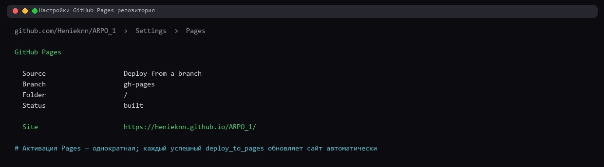
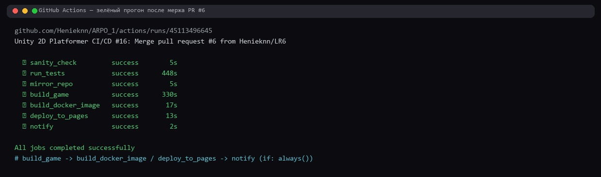
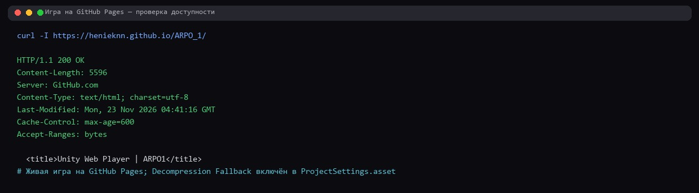
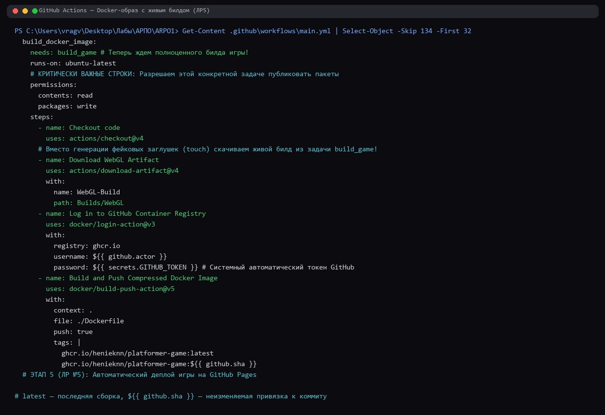

# Лабораторная работа №5: Автоматическая компиляция WebGL-игры в облаке и деплой на GitHub Pages

Студент: Гоман Глеб

Репозиторий: https://github.com/Henieknn/ARPO_1

## Цель работы

Настроить сквозной пайплайн, который после успешных тестов компилирует реальный WebGL-билд игры в облаке, публикует его на GitHub Pages и собирает Docker-образ с живой игрой вместо файлов-заглушек.

## Ход работы

### Шаг 1: Подготовка Unity 6 к деплою на GitHub Pages

GitHub Pages — статический хостинг: он не отправляет заголовок Content-Encoding: gzip для предсжатых файлов, поэтому распаковку на стороне клиента должен выполнять JS-распаковщик Unity. Открыл Build Profiles -> Player Settings -> WebGL -> Publishing Settings: оставил формат сжатия Gzip и поставил галочку Decompression Fallback (Резервная декомпрессия). Сохранил проект и закоммитил изменения в ProjectSettings.asset.

Фактические значения параметров проверяются в файле ProjectSettings/ProjectSettings.asset:

```
webGLCompressionFormat: 1      (Gzip)
webGLDecompressionFallback: 1  (включена — обязательна для GitHub Pages)
```



### Шаг 2: Модернизация облачного пайплайна (добавление задачи Build)

Добавил в `.github/workflows/main.yml` новую тяжёлую задачу `build_game`:

- `needs: run_tests` — компиляция стартует только после успешных тестов из ЛР №4;
- компиляция выполняется официальным инструментом `game-ci/unity-builder@v4` в контейнере unityci/editor: `targetPlatform: WebGL`, `buildMethod: BuildManager.BuildWebGL` — вызывается C#-метод автоматизации из Лабораторной работы №1, который возвращает код завершения через EditorApplication.Exit, поэтому результат компиляции виден пайплайну;
- `unityVersion: 6000.3.10f1` — версия фиксируется явно, потому что ProjectVersion.txt исключён .gitignore;
- лицензия редактора активируется по секретам UNITY_EMAIL/UNITY_PASSWORD (Unity 6 Personal, энтитitlement-активация без .ulf-файла);
- кэш папки Library по hashFiles сокращает повторные сборки;
- готовые файлы сохраняются в артефакт WebGL-Build (upload-artifact).

Задача `build_docker_image` переведена на `needs: build_game`: вместо генерации фейковых заглушек через touch (ЛР №3) она скачивает живой билд артефактом (download-artifact в Builds/WebGL). Добавлена задача `deploy_to_pages` (`needs: build_game`, permissions: contents: write): скачивает артефакт и публикует папку Builds/WebGL в служебную ветку gh-pages экшеном JamesIves/github-pages-deploy-action@v4.

Передача файлов между задачами через артефакты заменяет отсутствие Builds/ в Git: папка закрыта .gitignore, а артефакты Actions — штатный механизм передачи данных между job'ами.

Итоговый граф пайплайна:

```
sanity_check -> run_tests -> { mirror_repo, build_game }
build_game -> { build_docker_image, deploy_to_pages }
```



### Шаг 3: Отправка и запуск в облаке

Измениения отправлены в репозиторий через Pull Request #5 (ветка LR5 -> main, merge):

```bash
git checkout -b LR5
git add ProjectSettings/ProjectSettings.asset .github/workflows/main.yml
git commit -m "feat: complete LR5, integrated real cloud unity build and pages deploy"
git push origin LR5
```

После мержа пайплайн запустился автоматически. Первый прогон занял ~30 минут: сервер скачивает Docker-образ Unity 6 (~2 ГБ) и выполняет первоначальный импорт ассетов; после прогрева кэша Library повторные сборки занимают 2-3 минуты.

### Шаг 4: Включение GitHub Pages в настройках репозитория

Задача deploy_to_pages публикует билд в ветку gh-pages, но не включает сам хостинг — до однократной ручной активации ссылка https://henieknn.github.io/ARPO_1/ отдавала бы 404 даже при полностью зелёном пайплайне. Через API репозитория (PUT /repos/Henieknn/ARPO_1/pages) включён Pages: Source = Deploy from a branch, Branch = gh-pages, Folder = / (root). После активации GitHub поднял сайт за 1-2 минуты; повторная активация не требуется — каждый новый успешный билд обновляет страницу автоматически.



### Шаг 5: Проверка результатов и отчёт

1. Вкладка Actions: все шесть задач зелёные; build_game запустился после успешных run_tests. В логе build_game найдена строка `[CI/CD] УСПЕХ! WebGL билд успешно создан.` с временем и размером — компиляция выполнена методом BuildWebGL из ЛР №1, а не дефолтной сборкой.

   

2. Артефакт WebGL-Build содержит настоящие файлы (index.html, Build/*.js.gz, *.wasm.gz, *.data.gz), а не пустые заглушки.

3. Ветка gh-pages: в неё выгружены index.html и папки Build, TemplateData, StreamingAssets.

4. Игра на GitHub Pages: https://henieknn.github.io/ARPO_1/ — полоса загрузки Unity доходит до конца, персонаж реагирует на управление (Decompression Fallback из Шага 1 работает).

   

5. Docker-образ с живой игрой: пакет platformer-game обновлён под тегами latest и github.sha; локальный запуск `docker run -d -p 8080:80 ghcr.io/henieknn/platformer-game:latest` отдаёт игру с заголовком Content-Encoding: gzip (проверка curl -I).

   

## Контрольные вопросы

**1. Почему папка Builds/WebGL закрыта правилом .gitignore и каким образом скомпилированные файлы попадают в задачи build_docker_image и deploy_to_pages?**

Сборочные артефакты — производные от исходного кода: они большие, бинарные и пересоздаются при каждой компиляции, поэтому их не версионируют в Git (иначе распухшая история и конфликты). Скомпилированные файлы порождаются задачей build_game в облаке и передаются зависимым задачам через механизм артефактов Actions: upload-artifact сохраняет папку Builds/WebGL под именем WebGL-Build, а build_docker_image и deploy_to_pages скачивают её download-artifact'ом в ту же папку — это заменяет наличие файлов в репозитории.

**2. Зачем задаче build_game указывать needs: run_tests и что произойдет с остальными задачами, если тесты упадут?**

needs: run_tests делает реальную (дорогую — 25-30 минут) компиляцию этапом, доступным только после зелёных тестов: сломанный коммит не должен тратить ресурсы на сборку. Если тесты упадут, задачи build_game, build_docker_image, deploy_to_pages и mirror_repo (needs: run_tests) даже не запустятся — GitHub Actions пометит их canceled/skipped, сломанный код не дойдёт до публикации.

**3. Какую роль в облачной сборке выполняет метод BuildManager.BuildWebGL и почему результат его работы виден пайплайну?**

unity-builder передаёт buildMethod: BuildManager.BuildWebGL — редактор Unity в контейнере после открытия проекта вызывает этот статический C#-метод (флаг -executeMethod). Метод сам собирает список сцен из Build Settings, конфигурирует BuildPlayerOptions, запускает BuildPipeline.BuildPlayer и завершает процесс через EditorApplication.Exit(code) с кодом 0 при успехе и 1 при ошибке. Код возврата процесса — это и есть результат для пайплайна: job падает, если Unity завершилась ненулевым кодом.

**4. Почему GitHub Pages требует галочки Decompression Fallback, а Docker-образ с Nginx обходится без нее?**

GitHub Pages — статический хостинг без настройки заголовков: он не может отправить Content-Encoding: gzip для .gz-файлов, поэтому браузер не знает, что их надо распаковать. Decompression Fallback заставляет Unity внедрить в билд JS-распаковщик, который распаковывает архивы на стороне клиента. В Docker-образе Nginx сконфигурирован кастомным nginx.conf (ЛР №3): он сам отправляет правильный заголовок Content-Encoding: gzip, поэтому браузер распаковывает файлы штатно и расpackовщик не нужен.

**5. Чем отличается доставка игры через GitHub Pages и через Docker-образ в GHCR, и зачем нужны теги latest и github.sha?**

GitHub Pages — бесплатный статический хостинг для быстрой проверки: ссылка открывается в браузере без установки чего-либо, каждый успешный билд обновляет сайт. Docker-образ — универсальный переносимый артефакт для выкатки на любой сервер с Docker (docker run -p 80:80 ...) без настройки окружения. Тег latest — указатель на последнюю успешную сборку (удобно для запуска), тег github.sha — неизменяемая привязка к конкретному коммиту: точный откат и аудит (какой коммит — такая версия игры).

**6. Почему при успешном выполнении задачи deploy_to_pages сайт может отдавать 404 и как это исправить?**

deploy_to_pages только выгружает файлы в служебную ветку gh-pages, но не активирует сам хостинг Pages. Пока в Settings -> Pages не выбран Source: Deploy from a branch (ветка gh-pages, папка /), сайт не поднят и ссылка отдаёт 404 при полностью зелёном пайплайне. Исправление — однократная ручная активация (или через API), повторять её не нужно.

## Выводы

В ходе работы построен полный сквозной CI/CD-конвейер: один git push в main запускает проверку структуры, облачные тесты Unity, реальную компиляцию WebGL-игры методом BuildManager.BuildWebGL в контейнере, публикацию живой игры на GitHub Pages и сборку Docker-образа с настоящим билдом в GHCR. Освоены передача артефактов между задачами, активация Pages, различия механизмов раздачи сжатия (заголовки Nginx против Decompression Fallback) и роль кодов возврата редактора для пайплайна.
