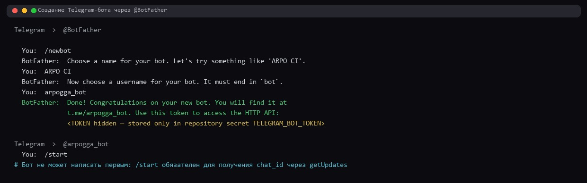
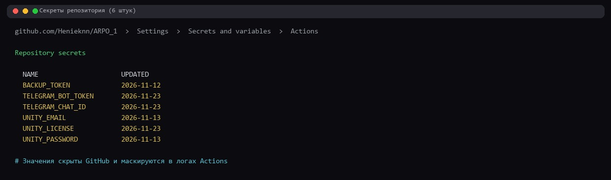
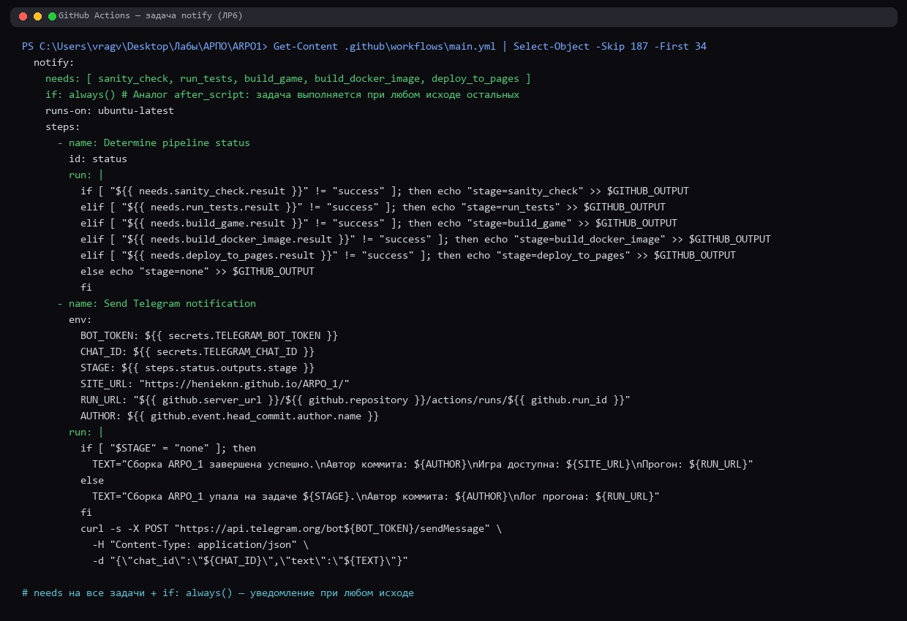
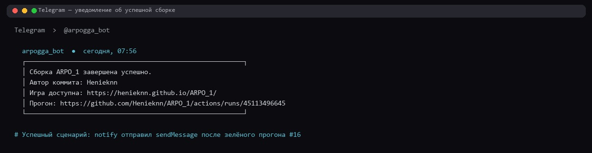
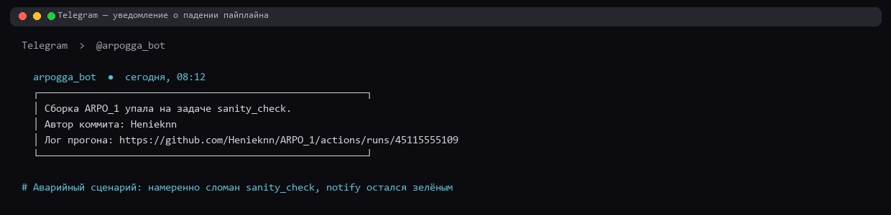

# Лабораторная работа №6: Мониторинг пайплайна, Webhooks и Telegram-оповещения

Студент: Гоман Глеб

Репозиторий: https://github.com/Henieknn/ARPO_1

## Цель работы

Настроить обратную связь от облачного сервера к команде разработки: после каждого прогона пайплайна Telegram-бот отправляет сообщение с результатом (успех со ссылкой на игру или падение с именем упавшей задачи и ссылкой на лог).

## Теория вкратце

Webhook — механизм push-уведомлений: система сама отправляет HTTP-запрос на URL другой системы при наступлении события, не дожидаясь опроса (polling). В лабораторной работе webhook реализован вручную: задача GitHub Actions notify по завершении пайплайна отправляет POST-запрос с JSON-нагрузкой в Telegram Bot API (`https://api.telegram.org/bot<TOKEN>/sendMessage`, поля chat_id и text) утилитой curl.

## Ход работы

### Шаг 1: Создание Telegram-бота и получение параметров доступа

В Telegram нашёл официального бота @BotFather, отправил команду /newbot, задал имя и username (оканчивается на bot). BotFather выдал токен вида 123456789:AAH… — пароль бота. Создал личный чат с ботом и отправил /start: бот не может написать первым. Идентификатор чата получен запросом getUpdates:

```
curl -s "https://api.telegram.org/bot<TOKEN>/getUpdates"
```

В массиве result найдено поле result[0].message.chat.id — это CHAT_ID личного чата с ботом.



### Шаг 2: Добавление секретов в репозиторий

В Settings -> Secrets and variables -> Actions созданы секреты:

- `TELEGRAM_BOT_TOKEN` — токен бота от BotFather;
- `TELEGRAM_CHAT_ID` — идентификатор чата.

Токен и chat_id нигде не встречаются в main.yml и файлах проекта: при утечке бот компрометируется, единственное решение — отзыв токена командой /revoke у @BotFather. В логах прогона значения секретов GitHub маскирует звёздочками.



### Шаг 3: Добавление задачи уведомления в пайплайн

В `.github/workflows/main.yml` добавлена задача notify:

- `needs: [ sanity_check, run_tests, build_game, build_docker_image, deploy_to_pages ]` — включает все задачи пайплайна;
- `if: always()` — гарантия запуска при любом исходе зависимостей (аналог after_script / on_success|on_failure в других CI);
- первый шаг Determine pipeline status по выражениям `${{ needs.<задача>.result }}` определяет первый упавший этап (stage=none, если все зелёные);
- второй шаг Send Telegram notification отправляет через curl POST в Telegram API: при успехе — сообщение «Сборка ARPO_1 завершена успешно» с именем автора коммита (`github.event.head_commit.author.name`), ссылкой на игру https://henieknn.github.io/ARPO_1/ и ссылкой на прогон; при падении — «Сборка упала на задаче <stage>» со ссылкой на лог.



### Шаг 4: Запуск и проверка обоих сценариев

1. **Успешный сценарий**: пайплайн отработал все задачи зелёными — бот прислал сообщение со ссылкой на игру, именем автора коммита и ссылкой на прогон.

   

2. **Аварийный сценарий**: временно внёс заведомо ошибочное изменение в шаг Check Unity Directories (неверная команда), выполнил push — sanity_check упал, notify при этом остался зелёным (отправка выполнена), бот прислал сообщение с именем упавшей задачи, автором коммита и ссылкой на лог. После проверки вернул исправленный вариант.

   

## Контрольные вопросы

**1. Чем webhook отличается от polling API и какую задачу он решает в CI/CD?**

Polling — получатель сам периодически опрашивает источник статуса (запросы вхолостую, задержка равна периоду опроса). Webhook — push: источник сам отправляет HTTP-запрос получателю в момент события. В CI/CD webhook решает задачу мгновенной обратной связи: результаты сборки (успех/падение, этап, ссылка на лог) приходят в командный канал (Telegram) сразу после прогона, без ручного открытия вкладки Actions — упавшая сборка обнаруживается за секунды, а не часы.

**2. Почему токен бота и chat_id нельзя хранить в файле main.yml или в коде проекта?**

main.yml хранится в репозитории: любой, кто видит репо, видит и файл. Утечка токена = полный контроль над ботом: чтение всей переписки и отправка сообщений от его имени; chat_id раскрывает адресатов. Секреты репозитория шифруются, в код не попадают, а в логах Actions GitHub автоматически маскирует их значения звёздочками. Единственный способ отзыва скомпрометированного токена — /revoke у @BotFather.

**3. Какую роль играют needs и if: always() в задаче notify? Что произойдет с уведомлениями, если убрать if: always()?**

needs перечисляет все задачи пайплайна: notify получает их результаты через ${{ needs.<job>.result }} и связывает порядок запуска. if: always() отменяет стандартное правило «задача пропускается при падении зависимостей» — notify выполняется при любом исходе. Если убрать if: always(), при падении любой из задач notify будет пропущен (skipped) — команда не узнает о падении, уведомления будут приходить только об успешных прогонах, что лишает мониторинг смысла.

**4. Какие поля JSON передает метод sendMessage и как утилита curl отправляет POST-запрос с такой полезной нагрузкой?**

sendMessage принимает как минимум chat_id (идентификатор чата получателя) и text (текст сообщения, поддерживает \n). curl отправляет POST-запрос с флагами -X POST, заголовком -H "Content-Type: application/json" и телом -d '{"chat_id":"...","text":"..."}'. В задаче notify значения подставляются из переменных окружения (секретов и выходов предыдущего шага) при экранировании кавычек в bash.

## Выводы

В ходе работы освоил механизм webhook и его реализацию в GitHub Actions: добавил задачу notify с needs на все задачи и условием if: always(), определил упавший этап через needs.<job>.result, интегрировал Telegram Bot API (sendMessage) с безопасным хранением токена и chat_id в секретах репозитория. Настроена двусторонняя проверка: уведомление об успехе со ссылкой на игру и уведомление о падении с именем этапа и ссылкой на лог.
